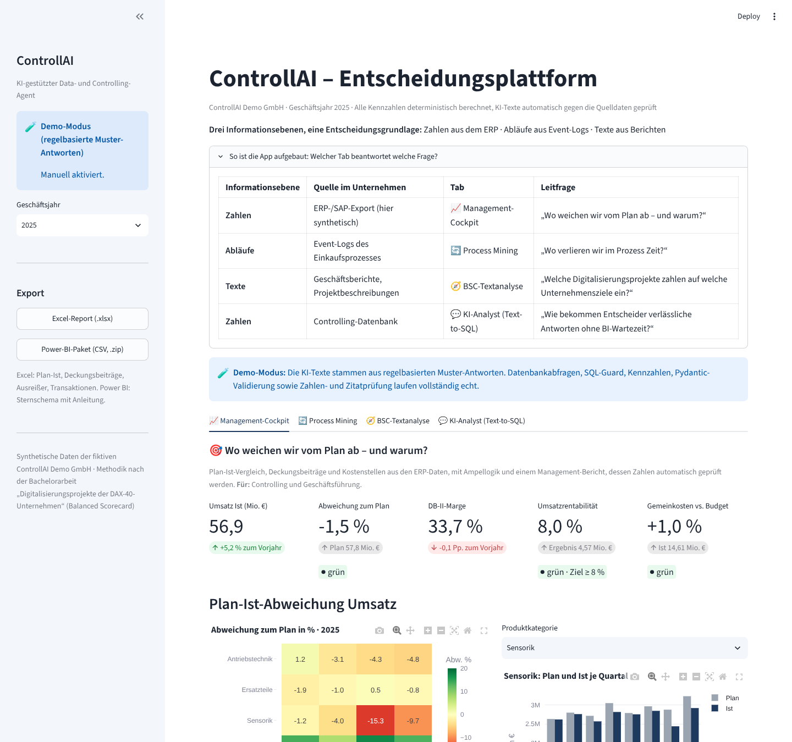
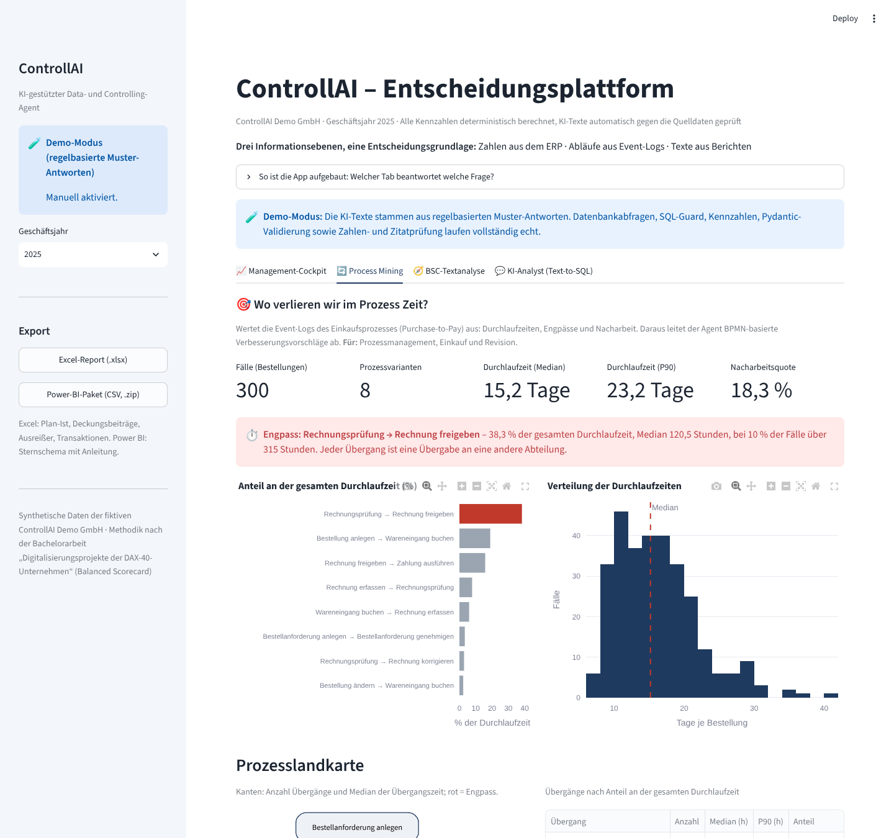
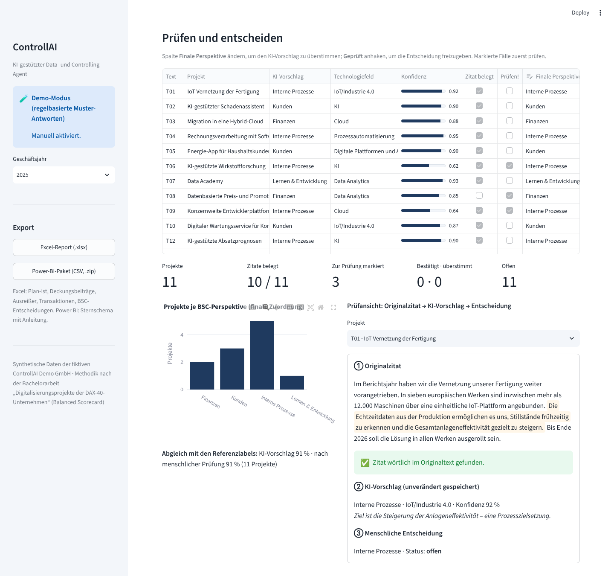
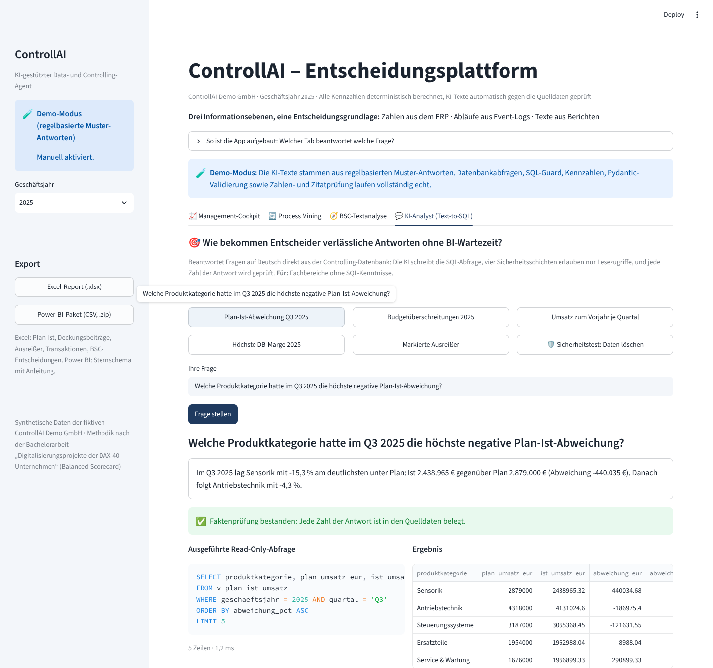
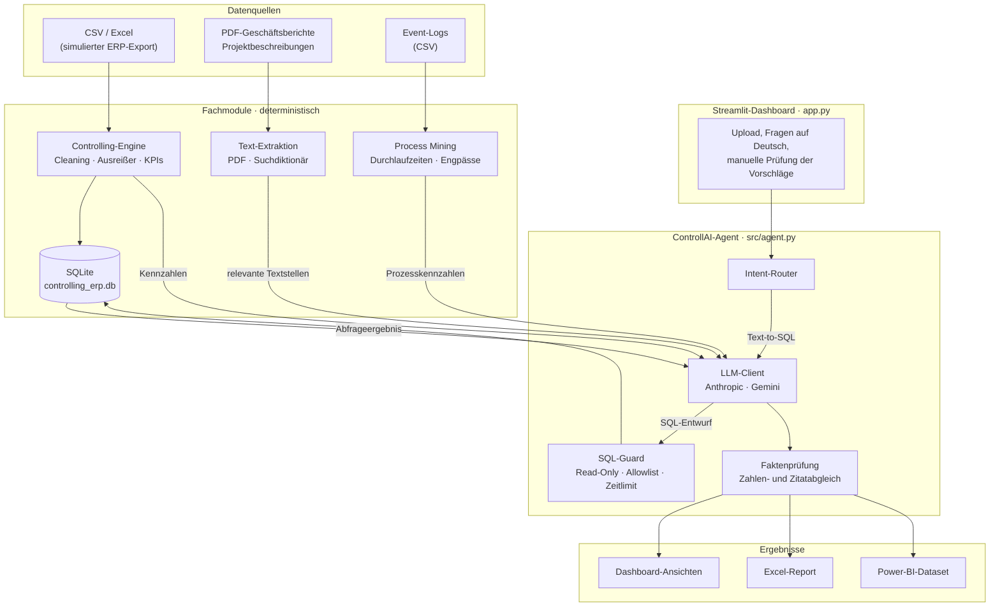
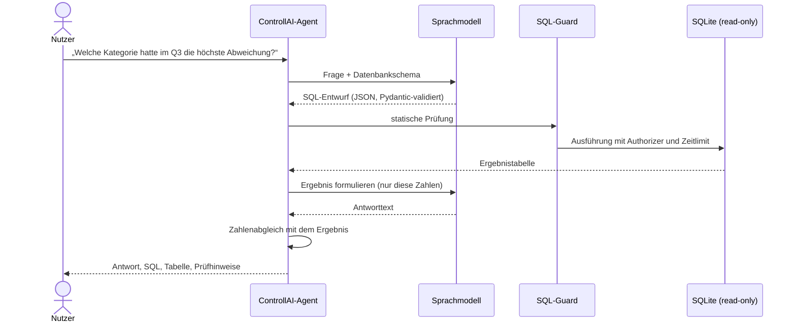

# Enterprise-BI-ControllAI-Agent

**KI-gestützter Data- und Controlling-Agent für die strategische Unternehmenssteuerung**

Der ControllAI-Agent verbindet klassische Controlling-Methoden mit großen Sprachmodellen (LLMs). Er beantwortet Fachfragen auf Deutsch direkt aus der Datenbank, ordnet Digitalisierungsprojekte aus Geschäftsberichten den vier Perspektiven der Balanced Scorecard zu, findet Engpässe in Geschäftsprozessen und fasst die Ergebnisse als Management-Bericht zusammen.

Das Grundprinzip: **Das Sprachmodell formuliert – es rechnet nicht.** Alle Kennzahlen entstehen deterministisch in SQL und pandas. Jede Zahl und jedes Zitat in einer KI-Antwort wird automatisch gegen die Quelldaten geprüft.


### Auf einen Blick: Drei Informationsebenen, eine Entscheidungsgrundlage

Managemententscheidungen scheitern oft daran, dass Zahlen, Abläufe und Texte getrennt ausgewertet werden. Der Agent führt alle drei Ebenen in einer Anwendung zusammen – jeder Tab des Dashboards beantwortet eine konkrete Leitfrage:

| Informationsebene | Quelle im Unternehmen | Modul (Dashboard-Tab) | Leitfrage | Für wen |
|---|---|---|---|---|
| **Zahlen** | ERP-/SAP-Export (hier synthetisch) | 📈 Management-Cockpit | „Wo weichen wir vom Plan ab – und warum?“ | Controlling, Geschäftsführung |
| **Abläufe** | Event-Logs des Einkaufsprozesses (Purchase-to-Pay) | 🔄 Process Mining | „Wo verlieren wir im Prozess Zeit?“ | Prozessmanagement, Einkauf, Revision |
| **Texte** | Geschäftsberichte, Projektbeschreibungen (PDF) | 🧭 BSC-Textanalyse | „Welche Digitalisierungsprojekte zahlen auf welche Unternehmensziele ein?“ | Strategie, digitale Transformation |
| **Zahlen** | Controlling-Datenbank | 💬 KI-Analyst (Text-to-SQL) | „Wie bekommen Entscheider verlässliche Antworten ohne BI-Wartezeit?“ | Fachbereiche ohne SQL-Kenntnisse |

---

## Inhalt

1. [Ausgangslage und Business Value](#ausgangslage-und-business-value)
2. [Dashboard und Schnellstart](#dashboard-und-schnellstart)
3. [Funktionsumfang](#funktionsumfang)
4. [Architektur](#architektur)
5. [Guardrails: Sicherheit und Faktentreue](#guardrails-sicherheit-und-faktentreue)
6. [Akademischer Hintergrund: BSC-Methodik](#akademischer-hintergrund-bsc-methodik)
7. [Demo-Daten](#demo-daten)
8. [Tests](#tests)
9. [Projektstruktur](#projektstruktur)
10. [Installation](#installation)
11. [Nutzung](#nutzung)
12. [Projektstatus und Roadmap](#projektstatus-und-roadmap)
13. [Autor](#autor)

---

## Ausgangslage und Business Value

Controlling-Abteilungen arbeiten mit drei Arten von Informationen: strukturierten Zahlen aus dem ERP-System, Prozessdaten aus Event-Logs und unstrukturierten Texten wie Geschäftsberichten oder Projektbeschreibungen. Sie werden meist getrennt ausgewertet – manuell, zeitaufwendig und abhängig von wenigen Personen, die SQL beherrschen.

Der ControllAI-Agent führt diese Welten in einem Werkzeug zusammen:

| Fragestellung im Unternehmen | Lösung im Agenten | Ergebnis |
|---|---|---|
| „Welche Produktkategorie hatte im Q3 die höchste Plan-Ist-Abweichung?“ | Text-to-SQL mit Read-Only-Ausführung | Antwort in Sekunden, inkl. nachvollziehbarer SQL-Abfrage |
| „Wie stark sind unsere Digitalisierungsprojekte auf Kunden statt auf Effizienz ausgerichtet?“ | BSC-Klassifikation von Berichten und Projektlisten | Projektportfolio nach vier Perspektiven, mit Belegzitat je Projekt |
| „Warum dauert die Rechnungsfreigabe so lange?“ | Process Mining auf Event-Logs | Engpässe, Wartezeiten, Nacharbeitsschleifen und BPMN-basierte Vorschläge |
| „Was muss die Geschäftsführung diese Woche wissen?“ | Faktengebundene Executive Summary | Kernaussagen, Handlungsempfehlungen, Datenlücken – Export nach Excel und Power BI |

**Nutzen für das Management:** schnellere Entscheidungsgrundlagen, weniger Abhängigkeit von manuellen Auswertungen, nachvollziehbare KI-Ergebnisse statt Blackbox.

---

## Dashboard und Schnellstart

```bash
pip install -r requirements.txt
streamlit run app.py
```

Die App öffnet sich unter `http://localhost:8501`. Fehlen die Demo-Daten, werden sie beim ersten Start automatisch erzeugt. **Ein API-Schlüssel ist nicht nötig:** Ohne Schlüssel startet die App im klar gekennzeichneten Demo-Modus (siehe unten).

| Tab | Inhalt |
|---|---|
| **Management-Cockpit** | KPI-Kacheln mit Ampellogik, Heatmap der Plan-Ist-Abweichungen, Plan-Ist-Verlauf je Produktkategorie, Kostenabweichungen, DB I/II, Bereinigungsstatistik des SAP-Exports, zur Prüfung markierte Ausreißer, Executive Summary mit Faktenprüfung |
| **Process Mining** | Durchlaufzeiten, Engpass-Hervorhebung, Prozesslandkarte, Varianten, BPMN-Optimierungsvorschläge |
| **BSC-Textanalyse** | Beispieltexte oder eigener PDF/TXT-Upload mit Vorfilterung über das Suchdiktionär, KI-Vorschläge mit Konfidenz und Zitatprüfung, Human-in-the-Loop: bestätigen oder überstimmen |
| **KI-Analyst** | Fragen auf Deutsch, Read-Only-SQL, Ergebnis, Faktenprüfung, Sicherheitstest mit einer schreibenden Anweisung |

In der Seitenleiste stehen der **Excel-Report** (formatierte Arbeitsmappe mit mehreren Blättern, inkl. der BSC-Entscheidungen) und ein **Power-BI-Paket** (CSV-Dateien im Sternschema mit Anleitung für Beziehungen und DAX-Measures) zum Download bereit.



<details>
<summary>Weitere Ansichten: Process Mining, BSC-Textanalyse, KI-Analyst</summary>





</details>

### Demo-Modus ohne API-Schlüssel

Ist kein Schlüssel hinterlegt, ersetzt `src/demo.py` das Sprachmodell durch regelbasierte Muster-Antworten. **Alles andere läuft echt:** Datenbankabfragen, SQL-Guard, Kennzahlen, Pydantic-Validierung sowie Zahlen- und Zitatprüfung. Die Antworttexte werden aus den tatsächlichen Abfrageergebnissen und Kennzahlen formuliert.

- Text-to-SQL: fünf Beispielfragen plus ein simulierter Angriff („Lösche alle Plandaten“), den der SQL-Guard blockiert
- BSC-Analyse: vorbereitete Vorschläge für die zwölf Beispieltexte – mit **bewusst eingebauten Schwachstellen** (niedrige Konfidenz, umformuliertes Zitat, abweichende Perspektive), damit Prüfmechanismen und Human-in-the-Loop sichtbar werden
- Executive Summary und BPMN-Vorschläge: berechnet aus der jeweiligen Faktenbasis

Mit `CONTROLLAI_DEMO=1` lässt sich der Demo-Modus auch bei vorhandenem Schlüssel erzwingen, etwa für Präsentationen.

---

## Funktionsumfang

### 1. Structured Data & Controlling Engine (SQL, pandas)
- SQLite-Datenbank im Stil eines SAP-S/4HANA-Exports: Kostenstellen, Material- und Kundenstamm, Fakturapositionen, Umsatz- und Kostenplanung, Plan-Ist-View
- Bereinigung echter SAP-Listexporte: Feldnamen der Fakturatabellen (VBRK/VBRP), ALPHA-Konvertierung (führende Nullen), deutsches Zahlenformat mit nachgestelltem Minus, Dubletten, Zwischensummenzeilen, Fremdwährung – mit Bereinigungsprotokoll
- Robuste Ausreißererkennung (MAD-basierter z-Wert nach Iglewicz & Hoaglin oder IQR, auf log-skalierten Beträgen) – Ausreißer werden **markiert, nicht gelöscht**; Stornos gelten als Geschäftsvorfall, nicht als Ausreißer
- Controlling-Kennzahlen: Plan-Ist-Abweichung (absolut, relativ, Bewertung günstig/ungünstig, Ampel), Deckungsbeitrag I/II, Umsatzrentabilität, YoY-Entwicklung
- **Text-to-SQL:** Fragen auf Deutsch werden in geprüfte, rein lesende SQL-Abfragen übersetzt; Spaltenkommentare im Datenbankschema helfen dem Sprachmodell bei der Interpretation

### 2. Unstructured Text & BSC-Classification Engine (NLP, LLM)
- Identifikation von Digitalisierungsprojekten und Zuordnung zu einer BSC-Perspektive (**Finanzen, Kunden, Interne Prozesse, Lernen & Entwicklung**) sowie zu einem Technologiefeld
- Je Projekt: Konfidenzwert, Begründung und wörtliches Belegzitat – das Zitat wird automatisch gegen den Originaltext geprüft
- PDF- und TXT-Upload; Vorfilterung über ein deutsch-englisches Suchdiktionär je Technologiefeld (`src/textextraktion.py`) mit Recall-Feld für allgemeine Digitalisierungsbegriffe und Ausschluss reiner Zahlenwerke – wie Stufe 1 der Bachelorarbeit
- 12 Beispieltexte mit Referenzlabels, darunter ein Negativbeispiel, PDF-Artefakte und ein Prompt-Injection-Test; das Dashboard zeigt die Übereinstimmung von KI-Vorschlag und menschlicher Entscheidung mit den Referenzlabels

### 3. Process Mining & Workflow-Check
- Event-Log eines Purchase-to-Pay-Prozesses (300 Bestellungen, 2.460 Ereignisse)
- Durchlaufzeiten (Mittelwert, Median, P90), Prozessvarianten, Übergangszeiten zwischen Aktivitäten, Nacharbeitsschleifen, Abteilungswechsel (BPMN: Lane-Wechsel)
- Engpass-Rangfolge nach Anteil an der gesamten Durchlaufzeit; Übergabe der Kennzahlen an den Agenten für Optimierungsvorschläge in BPMN-Begriffen

### 4. Management-Reporting & Export
- Faktenbasis je Geschäftsjahr (`kennzahlen_bericht`) als Eingabe für die Executive Summary des Agenten
- Executive Summary auf Deutsch: Kernaussagen, priorisierte Handlungsempfehlungen, Risiken und Datenlücken – jede Zahl wird gegen die Faktenbasis geprüft
- Excel-Export (`src/exporter.py`): Übersichtsblatt plus Blätter für Plan-Ist Umsatz und Kosten, Deckungsbeiträge mit Vorjahresvergleich, Ausreißer, Transaktionen, BSC-Entscheidungen und Bereinigungsprotokoll – mit Euro- und Prozentformaten, Filtern, fixierter Kopfzeile und Ampelfarben
- Power-BI-Paket: Faktentabellen (Umsatz, Umsatzplan, Kosten) und Dimensionen (Datum, Periode, Produktkategorie, Material, Kunde, Kostenstelle) als CSV im deutschen Format, mit Anleitung für Beziehungen und DAX-Measures

---

## Architektur



**Ablauf einer Datenfrage (Text-to-SQL):**



---

## Guardrails: Sicherheit und Faktentreue

Ein KI-Agent im Controlling ist nur dann nützlich, wenn man seinen Ergebnissen trauen kann. Deshalb sind Schutzmechanismen fester Bestandteil der Architektur.

**Schutz vor SQL-Injection und Datenveränderung – vier unabhängige Schichten**

1. **Statische Prüfung:** genau eine Anweisung, nur `SELECT` oder `WITH … SELECT`, keine Kommentare, keine schreibenden oder administrativen Schlüsselwörter
2. **Read-Only-Verbindung:** Die Datenbank wird im Modus `mode=ro` geöffnet, zusätzlich `PRAGMA query_only = ON`
3. **SQLite-Authorizer mit Allowlist:** Erlaubt sind ausschließlich Lese-, Auswahl- und Funktionsoperationen; gefährliche Funktionen wie `load_extension` sind gesperrt
4. **Ressourcenlimits:** Zeitlimit je Abfrage und begrenzte Zeilenzahl

Blockierte Abfragen werden protokolliert und **nicht** zur „Korrektur“ an das Modell zurückgegeben. Nur fachliche Fehler wie eine falsch geschriebene Spalte lösen einen Korrekturversuch aus.

**Schutz vor Halluzinationen**

- **Zahlenabgleich:** Jede Zahl in einer generierten Antwort oder Executive Summary wird mit den Quelldaten verglichen – unter Berücksichtigung von Rundung, Prozentdarstellung sowie Tausend/Mio./Mrd. Unbelegte Zahlen werden im Dashboard markiert.
- **Zitatprüfung:** Jedes Belegzitat der BSC-Klassifikation muss wörtlich im Originaltext stehen. PDF-Artefakte wie Silbentrennung oder typografische Anführungszeichen werden vor dem Abgleich normalisiert.
- **Strukturierte Ausgaben:** Alle Modellantworten werden mit Pydantic validiert; ungültige Ausgaben werden mit Fehlerhinweis einmal neu angefordert.
- **Prompt-Injection-Schutz:** Dokumentinhalte werden klar als Analysematerial markiert. Anweisungen, die in einem hochgeladenen Bericht stehen, werden nicht ausgeführt.
- **Human-in-the-Loop:** Vorschläge mit niedriger Konfidenz oder unbestätigtem Zitat werden zur manuellen Prüfung markiert. Die finale Zuordnung trifft der Mensch; der ursprüngliche Modellvorschlag bleibt zur Nachvollziehbarkeit erhalten.

---

## Akademischer Hintergrund: BSC-Methodik

Das BSC-Modul basiert auf meiner Bachelorarbeit im Studiengang Digital Business Management (B.Sc.) an der Hochschule RheinMain, Wiesbaden Business School (2026). Gegenstand waren die in Geschäftsberichten kommunizierten Digitalisierungsprojekte der DAX-40-Unternehmen.

**Untersuchungsdesign**

- **Korpus:** Vollerhebung von 120 Konzerngeschäftsberichten (40 Unternehmen, Berichtsjahre 2023–2025)
- **Stufe 1:** Python-Vorfilterung mit einem deutsch-englischen Suchdiktionär und regelbasierte Ableitung von Projektvorschlägen
- **Stufe 2:** davon unabhängige LLM-gestützte Auswertung jedes Berichts
- **Stufe 3:** vollständige manuelle Prüfung jedes Vorschlags am Originaltext und deduktive Codierung nach einem Codierleitfaden
- **Ergebnis:** 487 bestätigte Projektnennungen, codiert nach den vier BSC-Perspektiven und sechs Technologiefeldern

**Ausgewählte Befunde:** Die Perspektiven *Interne Prozesse* und *Kunden* vereinen in allen drei Berichtsjahren rund 87 % der Projektnennungen; der Anteil KI-bezogener Projekte stieg von 16,8 % (2023) auf 28,0 % (2025).

**Was in dieses Projekt übernommen wurde**

| Element der Bachelorarbeit | Umsetzung im Agenten |
|---|---|
| Balanced Scorecard als Klassifikationsraster (Kaplan & Norton) | Vier Perspektiven als feste Werteliste im Datenmodell |
| Zuordnung nach der **Zielsetzung**, nicht nach der Technologie | Zentrale Entscheidungsregel im Klassifikations-Prompt |
| Einschlusskriterien für „Digitalisierungsprojekt“ | Drei Kriterien (konkretes Vorhaben, erkennbares Ziel, Umsetzungsstand) |
| Sechs Technologiefelder | Zweite Klassifikationsdimension je Projekt |
| Wörtliche Belegzitate mit automatischer Prüfung | Zitatabgleich gegen den Originaltext |
| Drei-Schichten-Prinzip: Originalzitat → Modellvorschlag → menschliche Entscheidung | Modellvorschlag bleibt erhalten, Prüfmarkierung für den Nutzer |

**Weiterentwicklung gegenüber der Arbeit:** In der Bachelorarbeit hat das Sprachmodell nur Projektkandidaten vorgeschlagen; die BSC-Codierung erfolgte vollständig manuell. Im Agenten liefert das Modell zusätzlich einen Zuordnungsvorschlag mit Konfidenzwert. Die manuelle Prüfung bleibt für unsichere Fälle verpflichtend vorgesehen.

**Grundlagenliteratur:** Kaplan, R. S. & Norton, D. P. (2018). *Balanced Scorecard: Strategien erfolgreich umsetzen*. Stuttgart: Schäffer-Poeschel. · Mayring, P. (2015). *Qualitative Inhaltsanalyse: Grundlagen und Techniken* (12. Aufl.). Weinheim: Beltz.

---

## Demo-Daten

Alle Daten erzeugt `src/seed_data.py` reproduzierbar mit festem Seed für die fiktive **ControllAI Demo GmbH**, einen mittelständischen Hersteller von Antriebs- und Steuerungstechnik (rund 57 Mio. € Umsatz, Geschäftsjahre 2024 und 2025).

Die Datenbank wird dabei nicht direkt geschrieben, sondern über die echte Pipeline aufgebaut: Ein „schmutziger“ SAP-Rohexport durchläuft Bereinigung und Ausreißererkennung, erst dann werden die Daten gespeichert. So prüft jeder Generatorlauf auch die Bereinigungslogik.

| Datei | Inhalt |
|---|---|
| `data/controlling_erp.db` | 7 Tabellen und 1 View, rund 4.560 Fakturapositionen, 8 Kostenstellen |
| `data/sample/sap_export_faktura.csv` | Rohexport im SAP-Listformat mit eingebauten Datenqualitätsproblemen |
| `data/sample/event_log_p2p.csv` | Event-Log Purchase-to-Pay |
| `data/sample/projekttexte.json` | 12 Berichtsauszüge fiktiver Unternehmen mit Referenzlabels |

**Eingebaute Befunde**, die Analyse und Agent wiederfinden sollen:

| Bereich | Befund |
|---|---|
| Umsatz | Sensorik im Q3 2025 rund 15 % unter Plan (Lieferengpass); Service & Wartung 2025 durchgehend über Plan |
| Marge | Antriebstechnik ab Q2 2025 mit höherer Materialkostenquote |
| Kosten | IT- und Softwarekosten im Q3/Q4 2025 rund 35–40 % über Budget (Cloud-Migration); Marketing Q2 2025; Energiekosten 2025 |
| Datenqualität | 30 Dubletten, 8 Zwischensummenzeilen, 3 Fremdwährungszeilen, 5 Fehlbuchungen, 8 Stornos |
| Prozess | Engpass bei der Rechnungsfreigabe durch die Bereichsleitung; rund 20 % Nacharbeit in der Rechnungsprüfung |

Alle Namen, Zahlen und Texte sind frei erfunden. Die Unternehmensnamen der Beispieltexte („Muster Automobil AG“, „Demo Versicherung AG“ …) sind bewusst als fiktiv erkennbar.

---

## Tests

Die Testsuite läuft mit einem simulierten Sprachmodell – **ohne API-Schlüssel, ohne Kosten, in wenigen Sekunden**:

```bash
pytest
```

| Bereich | Was geprüft wird |
|---|---|
| SQL-Sicherheit | 15 Angriffsmuster (DROP, DELETE, Mehrfachanweisungen, Kommentare, ATTACH, PRAGMA, `load_extension` …) werden blockiert und verändern keine Daten; Authorizer und Read-Only-Verbindung greifen jeweils auch einzeln; Zeit- und Zeilenlimit |
| Agentenablauf | Korrekturversuch bei SQL-Fehlern, aber **kein** Korrekturversuch bei Sicherheitsverstößen; nicht beantwortbare Fragen; leere Ergebnisse |
| Faktenprüfung | Belegte Zahlen in deutschem und englischem Format, Prozent und Mio. werden akzeptiert; erfundene Zahlen werden markiert |
| Zitatprüfung | Silbentrennung, typografische Anführungszeichen und Leerzeichen werden toleriert; umformulierte Zitate abgelehnt |
| Pydantic | Ungültige Perspektiven, Technologiefelder und Konfidenzwerte scheitern; ungültiges JSON wird einmal neu angefordert |
| Prompt Injection | Eingeschleuste Abgrenzungsmarker werden neutralisiert |
| Analytics | Plan-Ist und Ampel, Deckungsbeitrag, YoY an exakten Beispielen; die eingebauten Befunde werden gefunden; Python-Berechnung und SQL-View stimmen überein |
| Process Mining | Engpass, Nacharbeitsquote und Varianten; exakte Übergangszeiten an einem Minimal-Log |
| Reproduzierbarkeit | Zwei Generatorläufe mit gleichem Seed liefern identische Daten |
| Export | Excel: Blätter, Zeilenzahlen, Zahlenformate, Ampelfarben, Blattnamen; Power BI: verlustfreie Zahlen trotz Dezimalkomma, eindeutige Schlüssel, referenzielle Integrität zwischen Fakten und Dimensionen |
| Textextraktion | PDF wird seitenweise gelesen; Zahlenwerke und themenfremde Seiten fallen heraus; „KI“ wird nicht in „Kinder“ oder „Skizze“ gefunden |
| Demo-Modus | Fallback ohne API-Schlüssel; alle Beispielantworten bestehen die Faktenprüfung; eingebaute Schwachstellen werden markiert; Prompt Injection wird nicht befolgt |
| Dashboard | Oberflächentests mit Streamlits `AppTest`: Start im Demo-Modus, Leitfrage je Tab, Engpass-Hinweis, Bericht, BSC-Prüfung, Text-to-SQL, Sicherheitstest, Jahreswechsel |

Insgesamt 195 Tests, geprüft mit pandas 2.2 und 3.0. Die GitHub-Actions-Pipeline führt Linting (ruff) und Tests für Python 3.11 bis 3.13 aus.

---

## Projektstruktur

```text
Enterprise-BI-ControllAI-Agent/
├── README.md
├── LICENSE                        # MIT
├── pyproject.toml                 # Projekt-, pytest- und ruff-Konfiguration
├── requirements.txt
├── .env.example                   # Vorlage für API-Schlüssel und Einstellungen
├── .gitignore
├── .streamlit/config.toml         # Farbschema des Dashboards
├── app.py                         # Streamlit-Dashboard mit vier Tabs
│
├── src/
│   ├── __init__.py
│   ├── agent.py                   # KI-Agent: Router, LLM-Anbindung, Guardrails, Faktenprüfung
│   ├── analytics.py               # Bereinigung, Ausreißer, Plan-Ist, DB I/II, YoY, Process Mining
│   ├── demo.py                    # Demo-Modus: Muster-Antworten und Agent-Fabrik mit Fallback
│   ├── exporter.py                # Excel-Report und Power-BI-Paket
│   ├── seed_data.py               # Generator für Datenbank, SAP-Rohexport, Event-Log, Beispieltexte
│   └── textextraktion.py          # PDF-Text und Vorfilterung über das Suchdiktionär
│
├── prompts/                       # optional: überschreibt die Standard-Prompts aus agent.py
│
├── data/
│   ├── controlling_erp.db         # wird erzeugt, nicht versioniert
│   └── sample/
│       ├── sap_export_faktura.csv
│       ├── event_log_p2p.csv
│       └── projekttexte.json
│
├── docs/screenshots/              # Ansichten des Dashboards
│
├── tests/
│   ├── conftest.py                # Fixtures, simuliertes Sprachmodell (FakeLLM)
│   ├── test_agent.py              # Sicherheit, Faktentreue, BSC, Pydantic, Prompt Injection
│   ├── test_analytics.py          # Kennzahlen, Ausreißer, Process Mining, Generator
│   ├── test_demo.py               # Demo-Modus und Fallback ohne API-Schlüssel
│   ├── test_exporter.py           # Excel, Power BI, Textextraktion
│   └── test_app.py                # Oberflächentests des Dashboards (Streamlit AppTest)
│
└── .github/
    └── workflows/
        └── ci.yml                 # Linting und Tests für Python 3.11–3.13
```

---

## Installation

**Voraussetzungen:** Python 3.11 oder neuer. Ein API-Schlüssel für Anthropic oder Google Gemini ist optional – ohne Schlüssel läuft der Demo-Modus.

```bash
# 1. Repository klonen
git clone https://github.com/<benutzername>/Enterprise-BI-ControllAI-Agent.git
cd Enterprise-BI-ControllAI-Agent

# 2. Virtuelle Umgebung anlegen und aktivieren
python -m venv .venv
source .venv/bin/activate          # Windows: .venv\Scripts\activate

# 3. Abhängigkeiten installieren
pip install -r requirements.txt

# 4. Optional: Konfiguration anlegen und API-Schlüssel eintragen
cp .env.example .env               # Windows: copy .env.example .env

# 5. Demo-Daten und Datenbank erzeugen (macht das Dashboard beim ersten Start auch selbst)
python -m src.seed_data

# 6. Tests ausführen (ohne API-Schlüssel)
pytest

# 7. Dashboard starten
streamlit run app.py
```

**Kennzahlen ohne Sprachmodell ansehen** – zeigt die deterministische Faktenbasis für Controlling und Process Mining, die der Agent später verwendet:

```bash
python -m src.analytics
```

**Frage an die Datenbank stellen** (API-Schlüssel in `.env` erforderlich):

```bash
python -m src.agent "Welche Produktkategorie hatte im Q3 2025 die höchste Plan-Ist-Abweichung?"
```

---

## Nutzung

**Beispielfragen an die Controlling-Datenbank**

- „Wie hat sich der Umsatz je Quartal 2025 im Vergleich zum Vorjahr entwickelt?“
- „Welche Kostenstellen haben 2025 ihr Budget am stärksten überschritten?“
- „Welche Produktkategorie erzielte 2025 die höchste Deckungsbeitragsmarge?“

Zu jeder Antwort zeigt das Dashboard die ausgeführte SQL-Abfrage, die Ergebnistabelle und gegebenenfalls Prüfhinweise.

**Verwendung im eigenen Python-Code**

```python
from src.agent import AgentConfig, ControllAIAgent

agent = ControllAIAgent(AgentConfig.from_env())

antwort = agent.ask("Welche Produktkategorie hatte im Q3 die höchste Abweichung?")
print(antwort.antwort)
print(antwort.sql_result.sql)
print("Faktentreu:", antwort.ist_faktentreu)

bsc = agent.classify_bsc(berichtstext, source="Geschaeftsbericht_2025.pdf")
for projekt in bsc.bsc_initiativen:
    print(projekt.titel, projekt.perspektive, projekt.konfidenz, projekt.zitat_verifiziert)
```

**Kennzahlen berechnen und vom Agenten kommentieren lassen:**

```python
from src.analytics import analysiere_prozess, kennzahlen_bericht, lade_event_log

fakten = kennzahlen_bericht("data/controlling_erp.db", geschaeftsjahr=2025)
bericht = agent.generate_executive_summary(fakten, focus="Geschäftsjahr 2025")
print(bericht.antwort)                  # Markdown-Bericht
print(bericht.unverifizierte_zahlen)    # leer, wenn jede Zahl belegt ist

p2p = analysiere_prozess(lade_event_log("data/sample/event_log_p2p.csv"), prozessname="Purchase-to-Pay")
print(p2p.engpaesse(3))                 # Übergänge mit dem größten Zeitanteil
vorschlaege = agent.analyze_process(p2p.to_facts(), process_name="Purchase-to-Pay")
```

**Daten und Datenschutz:** Alle mitgelieferten Daten sind synthetisch erzeugt und enthalten keine echten Unternehmens- oder Personendaten. Geschäftsberichte werden aus urheberrechtlichen Gründen nicht im Repository abgelegt, sondern vom Nutzer hochgeladen. Über `SCHEMA_SAMPLE_ROWS=0` lässt sich verhindern, dass Beispielzeilen der Datenbank an das Sprachmodell übermittelt werden.

---

## Projektstatus und Roadmap

| Baustein | Status |
|---|---|
| KI-Agent mit Guardrails und Faktenprüfung (`src/agent.py`) | fertig |
| Synthetische Demo-Daten im S/4HANA-Stil (`src/seed_data.py`) | fertig |
| Controlling-Engine: Bereinigung, Ausreißer, Plan-Ist, DB I/II, YoY (`src/analytics.py`) | fertig |
| Process Mining: Durchlaufzeiten, Varianten, Engpässe, Nacharbeit (`src/analytics.py`) | fertig |
| BSC-Engine: PDF-Extraktion und Vorfilterung über Suchdiktionär (`src/textextraktion.py`) | fertig |
| Reporting: Excel-Report und Power-BI-Paket (`src/exporter.py`) | fertig |
| Streamlit-Dashboard mit Demo-Modus (`app.py`, `src/demo.py`) | fertig |
| Abgleich der BSC-Vorschläge mit Referenzlabels (im Dashboard) | fertig |
| Testsuite (195 Tests) und CI-Pipeline | fertig |

**Mögliche Erweiterungen:** Anbindung an PostgreSQL oder SAP Datasphere, Rollen- und Rechtekonzept, Persistenz der BSC-Entscheidungen in der Datenbank, Vergleich mehrerer Sprachmodelle für die BSC-Klassifikation auf einem größeren Referenzdatensatz, Docker-Image.

---

## Autor

**Sherwan Shweish** – B.Sc. Digital Business Management, Hochschule RheinMain
Schwerpunkte: Datenanalyse, Controlling, Prozessmanagement und digitale Transformation

[LinkedIn](https://www.linkedin.com/in/sherwan-shweish)

## Lizenz

Dieses Projekt steht unter der [MIT-Lizenz](LICENSE).
